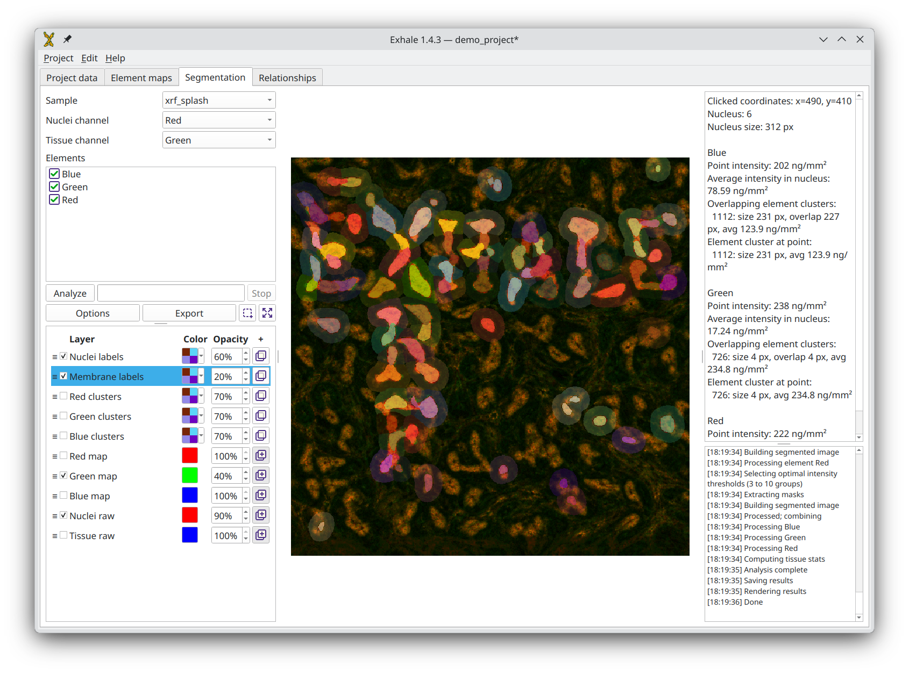

# Exhale
## Efficient X-ray Hub Aiding Lung Explorations

<p align="center">
  
</p>

This project aims to develop a specialized tool for investigating elemental aspects of chronic lung diseases. 

From the [VINNOVA project
description](https://www.vinnova.se/en/p/exhale--efficient-x-ray-hub-aiding-lung-explorations/):  
The purpose of this project is to advance understanding and treatment of
chronic lung diseases, leading causes of mortality worldwide, by
characterizing elements in lung tissue suspected to impact their
pathogenesis. The industrial partners TrulyLabs and AnaMar in collaboration
with MAX IV, Lung Biology and Correlative Image Processing and Analysis
(CIPA) fom Lund University, aim to streamline a workflow of X-ray imaging
studies for lung diseases, making these methods more accessible for
biomedical companies and clinical researchers.

## Currect functionality

* Loading HDF5 files with XRF data from the NanoMAX beamline at MAX IV.
* Composing element maps into publication-ready figures.
* Segmentation of cells and clustering of areas in element maps.

## Installation

EXHALE can be installed from PyPI in an isolated environment with
[uv](https://docs.astral.sh/uv/):

```bash
uv tool install --python 3.12 --with-requirements https://raw.githubusercontent.com/ctroein/exhale/main/requirements-cellpose.txt exhale-lung
```

Windows and macOS users who prefer a packaged application over uv or pip can
download it from the [GitHub releases page](https://github.com/ctroein/exhale/releases).
For a pip environment, install with the additional CellposeDINO requirement:

```bash
python -m pip install exhale-lung -r https://raw.githubusercontent.com/ctroein/exhale/main/requirements-cellpose.txt
```

The requirements file pins DINOv3 to the upstream revision tested with Exhale.
DINOv3 is not on PyPI, so a bare `pip install exhale-lung` does not provide
CellposeDINO support. The pinned source archive is installed by pip; Git is not
required. Frozen installers already contain these libraries.

For a Git checkout, install the additional dependency with
`python -m pip install -r requirements-cellpose.txt` and run `./run_exhale.py`.
The regular dependencies declared in `pyproject.toml` must also be installed in
that environment.

Trained Cellpose weights are downloaded on first use to the model directory in
application settings. The same mechanism is used for installed applications and
Git checkouts; the large weights are not included in the application installer.
DINOv3 code and derived model weights retain the [DINOv3 license](exhale/resources/licenses/DINOv3-LICENSE.md).

On Linux, run the following command to add EXHALE to the current user's desktop
environment and application menu:

```bash
exhale --install-desktop
```

To remove the desktop and menu entry, run:

```bash
exhale --remove-desktop
```

To uninstall an EXHALE installation managed by uv, run:

```bash
uv tool uninstall exhale-lung
```

## Developer documentation

Developer documentation is located in [`docs/`](docs/README.md).
